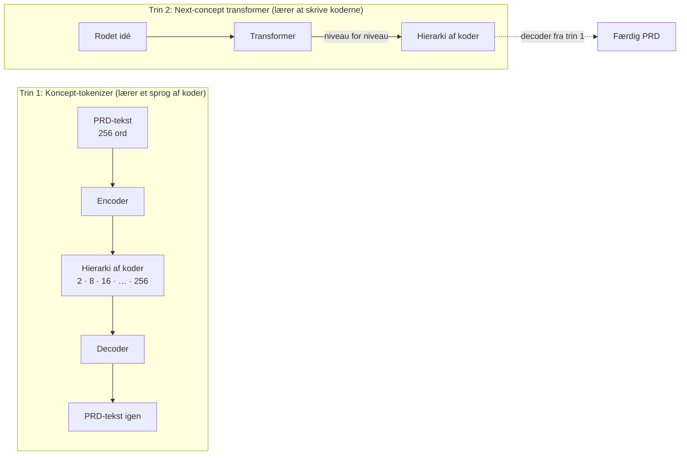

# Sådan virker TinyPRD

Denne side forklarer modellen fra bunden, i almindeligt sprog. Fagord står i [ORDBOG.md](ORDBOG.md).

---

## 1. Tre måder at skrive tekst på

Forestil dig, at du skal skrive en PRD på 256 ord.

**Autoregressiv (som ChatGPT):** Du skriver ét ord ad gangen fra venstre mod højre. Det kræver
256 skridt, og du kan ikke planlægge slutningen, før du er der.

```text
problem → developers → cannot → see → which → ... (256 skridt)
```

**Diffusion:** Du starter med en side fuld af støj og retter *hele* siden igen og igen, fx 128
gange. Hvert skridt arbejder på alle 256 ord.

**Next-Concept Modeling (NCM):** Du starter med et groft overblik og tilføjer detaljer lag for lag,
ligesom en kunstner, der først skitserer og bagefter maler detaljer:

```text
niveau 1  (2 koder)    ░░░░░░░░░░░░░░░░░░░░░░░░   "en PRD om ventetid på review"
niveau 2  (8 koder)    ▒▒▒▒▒▒▒▒▒▒▒▒▒▒▒▒▒▒▒▒▒▒▒▒   sektionerne tager form
niveau 4  (32 koder)   ▓▓▓▓▓▓▓▓▓▓▓▓▓▓▓▓▓▓▓▓▓▓▓▓   de vigtigste ord er på plads
niveau 8  (256 koder)  ████████████████████████   hvert ord er præcist
```

Hvert niveau laves i **ét enkelt skridt**, og alle koder i niveauet laves **parallelt**. Med 8
niveauer skal modellen altså kun køre 8 gange, ikke 256.

Idéen kommer fra artiklen
[Next-Concept Modeling (Stanford Hazy Research, 2026)](https://hazyresearch.stanford.edu/blog/2026-10-12-ncm),
som igen bygger på [VAR](https://arxiv.org/abs/2404.02905), der gør det samme for billeder.

---

## 2. Overblik: to trin



- **Trin 1** lærer at *komprimere* en PRD til et hierarki af koder og at *pakke den ud* igen. Det
  svarer lidt til at opfinde et stenografisk sprog.
- **Trin 2** lærer at *skrive* i det stenografiske sprog, ud fra en idé, fra groft til fint.

De trænes hver for sig: først trin 1, som så fryses, og derefter trin 2.

---

## 3. Trin 1: koncept-tokenizeren

Kode: [`src/tinyprd/models/concept_tokenizer.py`](../src/tinyprd/models/concept_tokenizer.py)

### 3.1 Fra ord til vektorer
Hvert ord bliver til en vektor med 128 tal. En lille transformer (encoderen) lader ordene "tale
sammen", så hver vektor også ved noget om sin sammenhæng. Resultatet kaldes **z** og har formen
256 × 128.

### 3.2 Residual-kvantisering: beskriv det, der mangler
Nu skal z beskrives med koder. En **kode** er bare et nummer i en **kodebog**, en tabel med 512
vektorer. Hvert niveau har sin egen kodebog.

Tricket er at beskrive z i lag, hvor hvert lag kun beskriver det, de forrige lag *manglede*:

```text
rekonstruktion = 0
for hvert niveau k:
    rest      = z - rekonstruktion         # hvad mangler vi?
    lille     = pres resten ned til niveauets længde (fx 256 → 8)
    koder     = for hver plads: find nærmeste vektor i kodebogen
    rekonstruktion += stræk koderne ud igen (8 → 256)
```

Det svarer til at beskrive et beløb med mønter: først den største mønt, der passer, så den næste
til resten, og så videre. Niveau 1 med kun 2 koder må fange det vigtigste. Niveau 8 retter de
sidste småting.

> **Pres og stræk** sker med faste matricer (`layers.py`). At presse er at tage gennemsnit af
> nabopositioner. At strække er at blande de to nærmeste. Simpelt, og det virker på Macens GPU.

### 3.3 Fra koder tilbage til ord
Decoderen, endnu en lille transformer, får rekonstruktionen og gætter ordet på hver position.

### 3.4 Nested dropout: tving de grove niveauer til at give mening
Hvis decoderen altid fik alle 8 niveauer, kunne den ignorere de grove niveauer. Derfor får den
halvdelen af gangene **kun de første k niveauer**, men skal stadig gendanne hele PRD'en. Så lærer
de grove niveauer at bære den vigtigste information.

### 3.5 Hvad bliver trænet?
- **Rekonstruktions-loss:** blev ordene gendannet korrekt?
- **VQ-loss:** kodebøgerne flyttes mod de vektorer, de skal beskrive, og encoderen flyttes mod
  kodebøgerne.
- **Genbrug af døde koder:** koder, ingen har valgt i et stykke tid, flyttes hen til rigtige data,
  så hele kodebogen bliver brugt.

---

## 4. Trin 2: next-concept transformeren

Kode: [`src/tinyprd/models/generator.py`](../src/tinyprd/models/generator.py)

### 4.1 Input
For niveau k ser modellen:
1. **Idéen**: de op til 48 ord, brugeren skrev.
2. **PRD'en indtil nu**: rekonstruktionen fra niveau 1 til k-1, presset ned til niveau k's
   længde.

Den skal så gætte **alle koder i niveau k på én gang**.

### 4.2 Træn alle niveauer i ét skridt
Under træning kender vi de rigtige koder, så alle niveauers input kan bygges på forhånd og sættes
efter hinanden:

```text
[ idé | niveau 1 | niveau 2 | niveau 3 | ... | niveau 8 ]
```

En **blok-diagonal attention-maske** sørger for, at hver blok kun kigger på idéen og sig selv:

```text
              idé  niv1  niv2  niv3
     idé      ██    ·     ·     ·
     niv1     ██   ██     ·     ·
     niv2     ██    ·    ██     ·
     niv3     ██    ·     ·    ██
```

Det er nok, fordi hvert niveau allerede har de grovere niveauer med i sit input.

**Smart sideeffekt:** Fordi blokkene ikke kan se hinanden, kan hver blok lige så godt køres for
sig som `[ idé | niveau k ]`. Det giver præcis det samme resultat, men er meget billigere, for
attention koster *længde²*. Én lang sekvens på 746 positioner koster 746² ≈ 556.000, mens de otte
korte blokke tilsammen kun koster ca. 210.000. Generering gør præcis det samme.

### 4.3 Forstyrrelse: lær at tåle egne fejl
Når modellen genererer, er de grove niveauer dens *egne* gæt, og de har fejl. Hvis den kun havde
trænet på perfekte grove niveauer, ville den blive forvirret. Derfor bytter vi under træning
50 % af koderne i niveau 1 ud med tilfældige, faldende til 10 % i det sidste niveau. Målet, det
modellen skal gætte, er stadig de rigtige koder.

### 4.4 Generering

Kode: [`src/tinyprd/sampling.py`](../src/tinyprd/sampling.py)

```text
rekonstruktion = 0
for k = 1 … 8:
    koder = generator(idé, rekonstruktion)     ← ét forward pass, alle koder parallelt
    rekonstruktion += tokenizer.bidrag(k, koder)
PRD = tokenizer.decoder(rekonstruktion)
```

Med `tinyprd generate "..." --levels` kan du se teksten efter hvert niveau og følge, hvordan
PRD'en kommer i fokus.

---

## 5. Baseline: til sammenligning

Kode: [`src/tinyprd/models/baseline.py`](../src/tinyprd/models/baseline.py)

En almindelig autoregressiv transformer i samme størrelse, trænet på præcis de samme data. Den
skriver ét ord ad gangen. Den er med, så vi kan svare på projektets forskningsspørgsmål: **hjælper
groft-til-fint generering en lille model?** Se [EKSPERIMENT.md](EKSPERIMENT.md).

---

## 6. Kort over koden

Koden ligger i `src/tinyprd/`, delt i `data/`, `models/` og `web/`. Læs gerne filerne i denne rækkefølge:

| Fil | Hvad den gør |
|---|---|
| [`prd.py`](../src/tinyprd/data/prd.py) | Hvordan en PRD ser ud, som data og som tekst |
| [`synth.py`](../src/tinyprd/data/synth.py) | Laver det syntetiske datasæt (domæner × mønstre) |
| [`vocab.py`](../src/tinyprd/data/vocab.py) | Tekst ↔ ord-id'er |
| [`config.py`](../src/tinyprd/config.py) | Alle hyperparametre |
| [`layers.py`](../src/tinyprd/models/layers.py) | Transformer-blok og pres/stræk-matricer |
| [`concept_tokenizer.py`](../src/tinyprd/models/concept_tokenizer.py) | **Trin 1**: tekst ↔ hierarki af koder |
| [`generator.py`](../src/tinyprd/models/generator.py) | **Trin 2**: forudsiger koderne niveau for niveau |
| [`sampling.py`](../src/tinyprd/sampling.py) | Generering fra groft til fint |
| [`baseline.py`](../src/tinyprd/models/baseline.py) | Den autoregressive sammenligningsmodel |
| [`training.py`](../src/tinyprd/training.py) | Træningsløkkerne |
| [`critic.py`](../src/tinyprd/critic.py) | Giver en PRD point efter principperne |
| [`evaluate.py`](../src/tinyprd/evaluate.py) | Sammenligner NCM og baseline |
| [`cli.py`](../src/tinyprd/cli.py) | Kommandoerne `tinyprd` og `prd` |
| [`web/`](../src/tinyprd/web) | Webinterfacet (`tinyprd serve`) |

## 7. Forskelle fra den originale NCM-artikel

TinyPRD er en forenklet, lærerig udgave. De vigtigste forskelle:

| | NCM-artiklen | TinyPRD |
|---|---|---|
| Størrelse | ca. 100M parametre | ca. 2M (tokenizer) + 6M (generator) |
| Data | Store tekstdatasæt (OpenWebText, LM1B …) | Syntetiske PRD'er |
| Tokenizer | GPT-2/BERT BPE | Simpelt ordforråd (ca. 750 ord) |
| Pres/stræk | Ikke beskrevet i detaljer | Faste gennemsnits- og interpolationsmatricer |
| Kodebog-træning | EMA-opdatering | Kodebogs-loss + genbrug af døde koder |
| Ekstra | Classifier-free guidance, MBR | Ikke med (kan være et næste skridt) |
